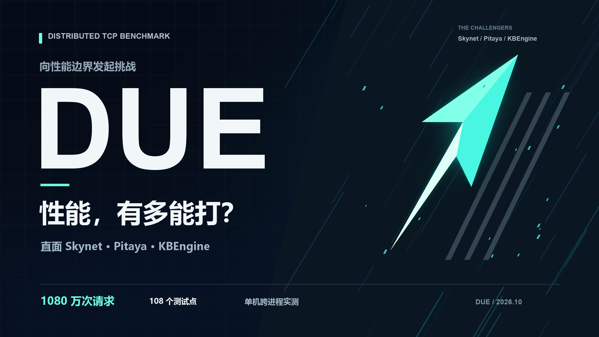
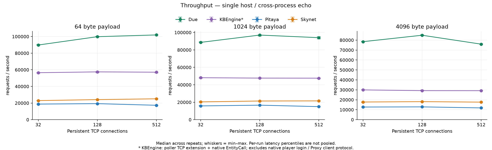
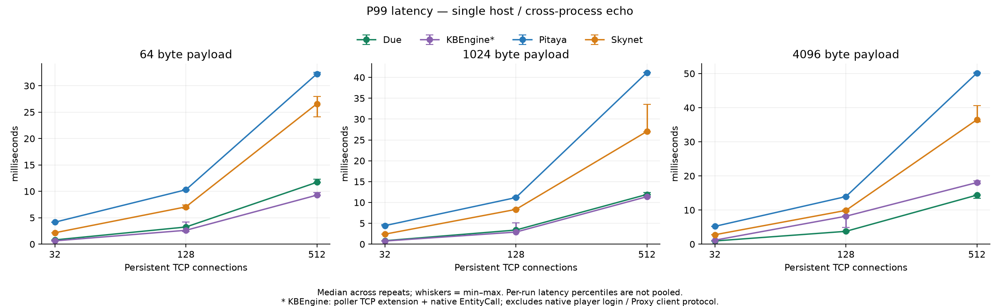
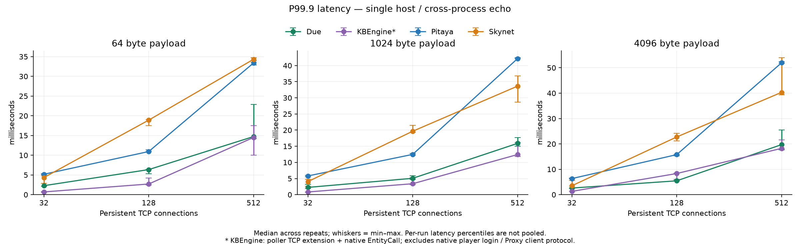
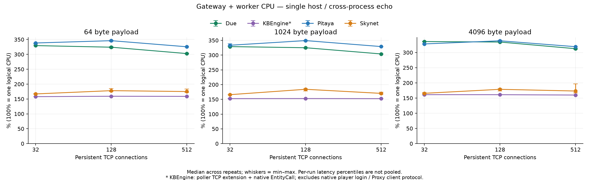
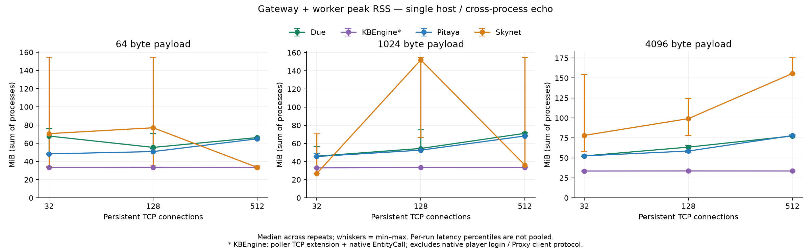
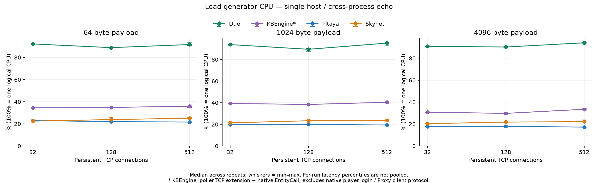

# due-benchmark



面向 [Skynet](https://github.com/cloudwu/skynet)、[Pitaya](https://github.com/topfreegames/pitaya)、[KBEngine](https://github.com/kbengine/kbengine) 和 [Due](https://github.com/dobyte/due) 的分布式架构 TCP 性能测评，以及 Due 网络、集群和日志模块的测试示例。

本文参考 [netpoll-benchmark](https://github.com/cloudwego/netpoll-benchmark) 的组织方式，提供测试场景、执行方法、环境配置与图表。本项目测量的是游戏服务器框架的跨进程调用链路，测试负载与 netpoll-benchmark 的 RPC 场景不同，两者数据不能直接比较。

**本次报告：[2026-10-21 四框架测试报告](comparison/reports/2026-10-21/REPORT.md)。** 已完成 108 个测试点、10,800,000 次正式请求，失败或跳过请求为 0。

> 本次结果来自一台机器上的跨进程 loopback 测试。KBEngine 采用官方 socket 扩展接入 TCP，再通过原生 EntityCall 转发，不包含原生玩家登录及 Proxy 客户端协议。结果反映下述适配方案在给定配置下的表现。

## 测试场景

使用同一个 Go 压测器，分别调用四个框架的 TCP 入口。每个框架均需要经过独立的网关进程和业务进程，再返回响应：

```text
压测器                 网关进程                 业务进程
  │                       │                       │
  ├──── TCP Request ──────►│                       │
  │                       ├──── 跨进程调用 ──────►│
  │                       │                       │ Echo
  │                       │◄────── 返回结果 ──────┤
  │◄──── TCP Response ────┤                       │
```

业务操作为 Echo：接收完整应用负载，经业务进程处理后原样返回。压测器逐字节校验响应内容，并按协议校验请求序号。该场景包含网络收发、协议处理、路由和跨进程调度，不包含数据库业务、复杂游戏逻辑或人为添加的处理延迟。

### 框架适配方式

| 框架 | TCP 入口 | 网关到业务进程 |
|---|---|---|
| Skynet | `skynet.socket`，4 字节大端包长 + 原始字节 | 原生 `cluster.call`，独立 worker |
| Pitaya | 原生 TCP Acceptor、握手及消息协议 | 原生集群路由与 gRPC，独立 backend |
| KBEngine | 官方文件描述符轮询扩展，4 字节大端包长 + 原始字节 | BaseApp → CellApp → BaseApp 原生 EntityCall |
| Due | 原生 TCP Gate、包头、路由号及序号 | 原生 DRPC over TCP，独立 Node |

四个适配器均位于 [comparison/](comparison/)。KBEngine 的 socket 由引擎事件循环驱动，业务转发经过原生实体调用；Skynet 同样使用自定义 TCP 分帧。各框架的协议与序列化开销保留在测量中，应用负载大小不包含框架协议包头。

本次只覆盖持久连接、每连接一个未完成请求的场景，未测试空闲连接比例、连接多路复用、登录风暴或跨机器部署。

## 测试设定

| 项目 | 配置 |
|---|---|
| 应用负载 | 64 B、1 KB、4 KB，其中 1 KB = 1024 字节 |
| 并发连接 | 32、128、512 个持久 TCP 连接 |
| 请求模型 | 闭环，每连接最多一个未完成请求 |
| 预热 | 每个测试点 10,000 次请求，不计入正式测量 |
| 正式请求 | 每个测试点 100,000 次 |
| 重复次数 | 每种组合 3 轮 |
| 请求超时 | 3 秒 |
| 测试规模 | 4 框架 × 3 种负载 × 3 种并发 × 3 轮 = 108 个点 |
| 执行顺序 | 使用固定随机种子打乱每轮框架和负载组合顺序 |
| 成功条件 | 响应内容、序号通过校验；失败或未完成请求使该点无效并停止测试 |

建连和握手在正式计时前完成。每轮为每个框架启动一组新服务进程，同一轮的九个负载点复用这组进程。

### 指标说明

- **QPS**：成功请求数除以正式测量耗时。
- **P99 / P99.9**：客户端往返延迟，包含链路中的排队与处理时间，按 nearest rank 计算。
- **服务 CPU**：网关、业务两个进程的 CPU 时间之和，100% 表示一个逻辑 CPU。
- **服务内存**：网关、业务两个进程的 RSS 之和，每 20ms 采样，取测量阶段采样峰值。
- **压测器 CPU**：单独记录，供分析发压端的资源使用情况。

图中的点为三轮中位数，误差线为三轮最小值至最大值。延迟图展示各轮分位数的中位数，不是合并所有请求后的总体分位数。

服务 CPU 和内存**不包含** etcd、Redis、MySQL 及 KBEngine 管理组件。RSS 可能重复计算共享页，也会受到前序负载、分配器及 GC 保留内存的影响。

## 开始测试

### 目录结构

```text
comparison/
├── configs/       # 测试矩阵、固定源码版本及源码/二进制指纹
├── loadgen/       # 通用 Go 压测器及各框架协议适配
├── skynet/        # Skynet 网关、业务服务及配置
├── pitaya/        # Pitaya frontend/backend 与专用 etcd
├── kbengine/      # KBEngine 运行资产及 Echo 实体
├── due/           # Due Gate/Node 适配器
├── scripts/       # 构建、运行、采样、绘图及报告生成
└── reports/       # 已完成的测评报告、原始数据及图表
```

仓库中的 [cluster/](cluster/)、[network/](network/) 和 [log/](log/) 保留 Due 各模块的测试代码。四框架横向测评使用独立的 `comparison/` 目录。

### 环境要求

- **运行环境**：Linux、Python ≥ 3.6、`taskset`、Docker。
- **构建工具**：Go 1.27.1，以及 Skynet、KBEngine 所需的 GCC/G++、make 和 MySQL 开发依赖。
- **源码**：外部框架使用固定 commit；Due 使用本仓库旁的 `../due` 本地源码。
- **基础设施镜像**：`redis:6.2.18`、`mysql:5.7`，运行前准备到测试机本地。
- **绘图环境**：本次使用 Python 3.12 与 matplotlib 3.11.2，可在测试机之外生成图表。

CPU 绑定脚本针对本次机器的逻辑 CPU 编号编写。更换机器时，应先核对物理核、兄弟线程关系，调整 [run.py](comparison/scripts/run.py) 中的 `CPUS` 配置。

### 构建与部署

在仓库根目录下载固定源码并交叉编译 Linux amd64 Go 二进制：

```bash
python3 comparison/scripts/build.py --fetch
```

已有源码时可省略 `--fetch`。该命令构建压测器、Due、Pitaya 和专用 etcd；Skynet、KBEngine 需要在 Linux 上分别构建，具体步骤见 [Skynet](comparison/skynet/README.md)、[Pitaya](comparison/pitaya/README.md)、[KBEngine](comparison/kbengine/README.md) 和 [Due](comparison/due/README.md) 的说明。

运行脚本采用以下部署布局，启动命令在 `/opt/framework-benchmark` 下执行：

```text
/opt/framework-benchmark/
├── comparison/    # 适配代码；bin/ 中放置已构建的 Linux 二进制
├── src/
│   ├── skynet/    # 已编译的固定版本 Skynet
│   └── kbengine/  # 已编译的固定版本 KBEngine
└── results/       # 每次运行独立保存数据与日志
```

### 执行测试

首次部署时准备 KBEngine 运行资产：

```bash
python3 comparison/kbengine/prepare.py src/kbengine
```

先验证四个框架的完整链路，再运行正式矩阵：

```bash
python3 comparison/scripts/run.py --smoke --out results/smoke
python3 comparison/scripts/run.py --out results/formal
```

也可以通过 `--frameworks skynet pitaya kbengine due` 显式选择待测框架。`--out` 必须是尚不存在的目录，避免混入旧数据。控制器检查测试端口，启动独立基础设施，并在退出时清理本次创建的进程和容器。

### 生成图表与报告

在具备绘图依赖的环境中执行：

```bash
python3 -m pip install -r comparison/scripts/requirements-charts.txt
python3 comparison/scripts/plot.py results/formal/results.jsonl --out-dir results/formal/charts
python3 comparison/scripts/report.py results/formal
```

绘图输出 PNG、SVG 和统计 CSV；报告生成器核对完整矩阵、重复次数和请求成功数，不接受不完整或含失败请求的数据。完整方法见 [comparison/README.md](comparison/README.md)。

## 参考数据：2026-10-21

### 测试环境

| 项目 | 配置 |
|---|---|
| CPU | Intel Core i5-10400F @ 2.90GHz，6 物理核 / 12 逻辑线程 |
| 内存 | 32 GB |
| 操作系统 | CentOS 7，Linux 3.10，x86_64 |
| Go | 1.27.1 |
| GCC / G++ | 4.8.5 |
| 部署 | 单机 loopback，各框架依次运行 |
| 网关 CPU | 逻辑 CPU `0,6`，同一物理核的两个兄弟线程 |
| 业务 CPU | 逻辑 CPU `1,7`，同一物理核的两个兄弟线程 |
| 压测器 CPU | 逻辑 CPU `2,3,8,9`，另外两个物理核 |
| 新建基础设施 CPU | 逻辑 CPU `4,10` |

Go 网关与业务进程均设置 `GOMAXPROCS=2`，Skynet 两个进程均设置 `thread=2`。宿主机已有服务保持运行；CPU 亲和性限制本测试进程的运行范围，不等于全机独占。

### 源码版本

| 框架 | 测试版本 |
|---|---|
| Skynet | [`64391f732e76`](https://github.com/cloudwu/skynet/commit/64391f732e76507ea6615f312cb71be1fd7bfbdd) |
| Pitaya | [`f3d0af570f76`](https://github.com/topfreegames/pitaya/commit/f3d0af570f76e2608aee35900dcea20015b36978) |
| KBEngine | [`7d379b9f943d`](https://github.com/kbengine/kbengine/commit/7d379b9f943d2731b09c45398855f98efe74d046) |
| Due | 本地源码快照，基于 `8f44429a84ce`，见 [源码指纹](comparison/reports/2026-10-21/due-manifest.json) |

这些是本次固定的源码版本，不统一标称为稳定发布版本。Skynet 使用 glibc malloc 及 GCC 4.8 兼容构建参数；Pitaya 关闭消息压缩、连接限流，并将框架独立 logger 设为 Error。完整构建条件见各适配器说明与 [测试报告](comparison/reports/2026-10-21/REPORT.md)。

### 1 KB 报文、128 个连接

下表所有指标均为三轮中位数；QPS 括号内为三轮范围。

| 框架 | QPS（min–max） | P99（ms） | P99.9（ms） | 服务 CPU（%） | 服务 RSS（MiB） |
|---|---:|---:|---:|---:|---:|
| Skynet | 21,410（21,133–21,642） | 8.330 | 19.655 | 184.1 | 152.0 |
| Pitaya | 16,625（16,529–16,625） | 11.166 | 12.478 | 349.1 | 52.6 |
| KBEngine | 47,669（47,441–47,902） | 2.893 | 3.391 | 152.8 | 33.5 |
| Due | 97,005（95,935–97,234） | 3.381 | 5.068 | 325.0 | 54.4 |

在这一负载条件下，Due 的吞吐量最高，KBEngine 此适配方案的 P99、P99.9 更低。Due 同时使用了更多 CPU，不能将吞吐差异直接解释为单位 CPU 效率差异。其余负载组合见下图及完整统计。

### 吞吐量



### P99 延迟



### P99.9 延迟



### 服务 CPU



### 服务内存



### 压测器 CPU



### 测试报告与原始数据

- [完整测试报告](comparison/reports/2026-10-21/REPORT.md)：测量窗口、结果、环境及适用范围。
- [统计数据 CSV](comparison/reports/2026-10-21/charts/summary.csv)：36 组负载的三轮统计。
- [原始结果 JSONL](comparison/reports/2026-10-21/results.jsonl)：108 个正式测量点。
- [运行配置](comparison/reports/2026-10-21/metadata.json)、[测试源码归档](comparison/reports/2026-10-21/test-sources.tar.gz)及[原始日志](comparison/reports/2026-10-21/raw-logs.tar.gz)。
- [二进制 SHA256](comparison/reports/2026-10-21/binaries-sha256.txt)及[报告产物校验值](comparison/reports/2026-10-21/deliverables-sha256.json)。
- [SVG 图表及其他产物](comparison/reports/2026-10-21/charts/)。

## 结果适用范围

这些结果用于比较给定版本和资源配置下的跨进程 Echo 链路，不代表真实游戏业务或框架所有模式的总体排名。

本次采用闭环请求模型，不作 coordinated-omission 修正，不能据此推断开放流量过载时的延迟保障。服务资源图也不代表整套集群的总成本，尤其没有计入各框架不同的注册中心、数据库与管理服务开销。

三轮最小值至最大值已完整保留，但样本不足以给出统计显著性或置信区间。4 个测试点持续时间不足 1 秒，其 CPU 读数应谨慎解释；压测器总 CPU 未用满配额也不能排除局部瓶颈。本项目不将本次 QPS 声称为各框架的理论上限。
